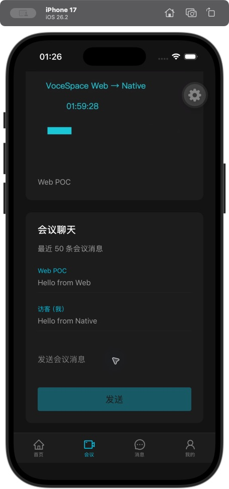

# 4.4 会议聊天与 iOS 实连交付

本批继续完成手动观众会议闭环。主色仍为 `#22CCEE`，UI 使用 Ant Design Native；没有增加账号、私信、公开发现或上麦权限。`NATIVE_CONFERENCE_SPACE` 仍默认关闭且只允许无子房间的测试 Space。

## 使用行为

- 正式确认加入后才启动聊天，展示最近 50 条会议消息；每条文字最多 4000 字符。Web 与 App 共用原来的聊天记录、可信发送者和消息去重规则。
- 先注册实时监听，再补历史；重连再次补齐最近记录，按发送者和 ID 去重。旧房间的历史、广播、发送确认不能写进下一次会话。
- 发送等待确认，失败保留草稿；内容未变时重试沿用同一个消息 ID。已经收到自身消息广播时，即使确认超时也不误报失败；发送期间新输入的草稿不会被上一条确认清空。
- 离线不缓存 Socket 待发写入，恢复后由用户明确重试。权限失效禁用发送并清空已加载消息；历史读取失败有单独重试入口。
- Web 文件消息在 App 显示“请在网页端查看”。本批没有文件上传、下载、私信、历史翻页或草稿跨进程持久化。
- 切 Tab、退出、进入后台时关闭本次聊天连接和监听、取消历史请求。媒体连接依然由原会议控制器拥有。

## 授权与协议

| 通道                               | 输入 / 约束                                                                                                             |
| ---------------------------------- | ----------------------------------------------------------------------------------------------------------------------- |
| POST `/api/v1/native/chat/history` | JSON `{joinId}`，Native Bearer；读取前后检查当前会话及已确认成员，返回 `{items}`，最多 50 条                            |
| Native Socket 握手                 | WebSocket 请求头 `X-Vocespace-Client: native`；Socket.IO `auth: {token, joinId}`，凭证不放 URL                          |
| `chat_msg`                         | `{joinId, id, roomName, message, type: 'text', file: null}`；服务端检查身份、会议绑定、成员与撤销状态，去除任意额外字段 |
| 确认                               | `{ok, id, duplicate}` 或 `{ok:false, code}`；仍使用原 Redis 原子入库和 24 小时去重键                                    |

iOS 的原生 WebSocket 会携带 Origin，不能直接套用 Web 页面的 Origin 白名单。传输标记只选择 Native 认证路径：标记请求不读取 Cookie，必须使用 Native 类型的 Bearer 会话及已确认的 joinId；浏览器会话即使作为 Bearer 传入也被拒绝。普通 Web 的 Origin 和 Cookie 规则保持原有约束。自定义 WebSocket 请求头受 Socket.IO 的 [Native 客户端支持](https://socket.io/docs/v4/client-options/#extraheaders)，浏览器 WebSocket 不能设置这些请求头。

服务端在握手、每次发送和广播前的接收方检查中复用 `canUseNativeChat`；prepared / cancelled、过期、身份绑定改变、非测试 Space、子房间、成员不存在或撤销标记均不允许聊天。Native 文件发送事件也被拒绝，不能用它绕过上传授权。历史响应采用字段白名单，文件只返回占位 DTO；旧记录缺 ID 时用稳定摘要作为显示键。

新增逻辑不创建另一套消息存储。继续使用 `chat:<space>`、`v1:message:<space>:<identity>:<id>`，并读取原 Native join / session / revoked 记录。本次未改变旧聊天 JSON 结构；存储损坏返回 503，不伪装成空记录。

## 实现位置

- `packages/contracts/src/conference-chat.ts`：文字输入校验、消息 DTO 和展示上限。
- `packages/server-core/src/native-chat.ts`：HTTP / Socket 共用的纯授权规则。
- `lib/server/native-chat.ts`、`services/api/native-chat.ts`：Redis/Space 适配和历史接口。
- `services/realtime/server.ts`：Native 传输认证、成员检查、可信文字广播及接收方撤销检查。
- `apps/mobile/src/chat`：稳定控制器、Hook 和界面；视图不持有 Socket。

## 已验证

自动检查：83 项单元/Hook 测试；73 项独立 HTTP、临时 Redis、Socket 检查，同时通过生产 Web 同站代理及最小 API 制品。包含未加入拒绝、浏览器 Cookie / 非 Native Bearer 拒绝、身份伪造、并发去重、消息上限、坏存储、撤销后读写、退出和迟到消息。全项目/Native 类型、依赖边界、API 构建、iOS/Android JS 导出通过。本批 Web 没有修改 UI，代理集成使用上一批已标准构建的隔离制品，未覆盖用户正在运行的 Web 构建目录。

真实本地 POC 使用独立 Redis/API、LiveKit 1.8.4 和浏览器 Web SDK 2.9.3，发布合成的实时画面与测试音轨；iPhone 17 / iOS 26.2 模拟器运行 RN SDK 3.0.0 / client 2.22.3：

1. SecureStore 保存并在 App 重启后恢复访客凭证，实际 RTC 加入成功。
2. 模拟器显示浏览器发送的实时视频，画面包含持续变化的时钟和位置。
3. Web → App 和 App → Web 文字收发成功，发送确认后清空原草稿。
4. 切“消息”Tab 后 Web 观众计数归零；再次加入能读取离开期间发送的消息，历史中没有重复。
5. 进入后台后只读查询 LiveKit，Native RTC 参与者数为 0。



本地 POC 并非正式 Web 页面端到端回归，也未验证真实麦克风、扬声器听感、蓝牙、弱网、E2EE、Android 或双端真机。LiveKit 1.8.4 在新 Native 客户端连接时出现新 RTC 路径不支持的告警，客户端回退后连接成功；部署版本兼容和性能仍应按正式环境验证。

## 复现隔离联调

前提：根 `.nvmrc` 对应的 Node、pnpm、已安装的 `redis-server` 与 `livekit-server` 命令，以及 iOS development build。以下脚本只建立临时数据、随机本地端口和测试凭证，不读取开发者配置。

```sh
pnpm build:api
node tests/manual/native-pilot.mjs
```

脚本打印 `apiOrigin`、`webOrigin` 和测试 Space `NativeChatPOC`。打开 `webOrigin`，点击发布测试视频，再启动指向该 API 的单独 Metro：

```sh
EXPO_PUBLIC_API_URL=http://127.0.0.1:脚本输出的API端口 \
NODE_OPTIONS=--dns-result-order=ipv4first \
pnpm --filter @vocespace/mobile exec expo start --dev-client --localhost --port 18082
```

模拟器开发客户端通过 Enter URL manually 连接 `http://127.0.0.1:18082`；在会议页输入 `NativeChatPOC`。可在两端发送测试文字、切 Tab、重新加入，核对历史。先退出 App 会议、关闭测试发布页，再 Ctrl-C 停止 Metro 和 POC 脚本；脚本会清理自己启动的服务与临时目录。它仅用于本机回环网络，不是真机部署方案。

iOS 必须保留正常签名。此前 `CODE_SIGNING_ALLOWED=NO` 构建可显示页面，但 SecureStore 报 `A required entitlement isn't present`；本次改用模拟器 ad-hoc 签名构建后实连通过，不需要修改凭证存储方案。手动构建可使用：

```sh
cd apps/mobile/ios
xcodebuild -workspace VoceSpace.xcworkspace -scheme VoceSpace \
  -configuration Debug -sdk iphonesimulator \
  -destination 'platform=iOS Simulator,name=iPhone 17' \
  CODE_SIGNING_ALLOWED=YES CODE_SIGN_IDENTITY=- build
```

如本机设置过 Windows 编译器变量，仅在构建命令前用 `env -u CC -u CXX -u AR -u LD` 清除。生成的 ios/android 目录不作为配置来源。

后续仍需显式上麦与摄像头权限、发布者退出确认、会话过期/进程被杀后的媒体补偿、外部身份适配、Android 原生及真机验证；4.5 的公开源授权、预览和延迟加入未被本批勾选。
