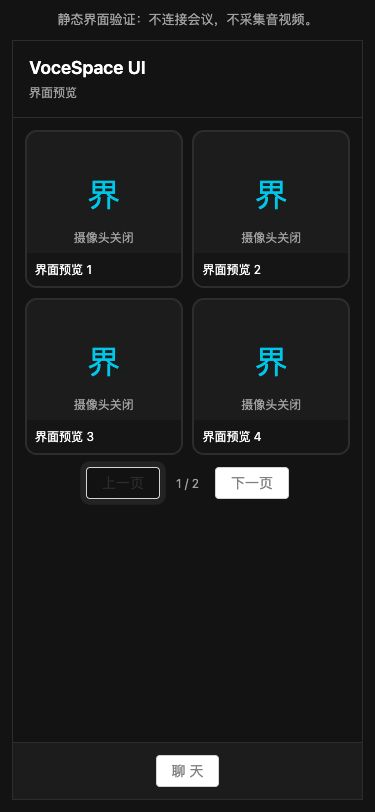

# 共享 Phone 会议 UI：小范围验证

> 2026-10-11：原 `meeting-ui` 已并入 `ui/src/meeting`，两端统一依赖 `@vocespace/ui`；下文双 UI 包结构仅为历史记录。

> 历史批次记录：用户现已确认验证完成并授权扩大迁移。当前 App 默认使用新版会中 UI；最新入口、交付范围和待验收项见 [扩大迁移说明](shared-meeting-ui-migration.md)。下文默认关闭等描述为原试验状态。

2026-10-10，按用户选择的方案一实施：单份 React Native 会议布局，Web 通过 react-native-web 渲染。默认入口继续使用已有界面；本批交付后等待用户测试，再扩大迁移。

## 试用入口

使用 `.nvmrc` 对应的 Node 24，执行 `pnpm install --frozen-lockfile`，重启 Web 和 Metro，以加载新的依赖与 workspace 包。API 使用原启动方式与配置。本批未修改本机 `.env.local`，未重启用户服务。

- **App**：`pnpm dev:mobile`，在「会议 → 加入会议」中打开「共享会议界面（试验）」，再加入已配置的测试 Space。开关默认关闭，仅保存在当前页面内存。退出后关掉开关即可对照原版；设备采集仍需要主持人邀请并由本人触发。
- **Web 实际会议**：以手机宽度打开 `/<Space名称>?meetingUi=shared`。已有查询参数时使用 `&meetingUi=shared`。该参数仅在 Phone 布局下生效；PC 继续使用原界面。首次进入请从带参数的房间链接开始，不要在会议中刷新地址来切换版本。
- **静态预览**：`/labs/meeting-ui`，包含 6 个演示成员，便于验证分页、固定画面和聊天草稿。页面明确标注不连接会议、不采集媒体；它不是公开会议 feed 或实时预览。

App 原有 development build 可用于本批 JS 界面验证，本次未增加原生模块。若 Expo 提示找不到 development build，沿用原先 `pnpm --filter @vocespace/mobile ios` 安装流程。切勿将 Expo Go 或 JS 导出当作 LiveKit 原生验收。

## 实现与边界

| 位置 | 当前职责 |
| --- | --- |
| `packages/meeting-core` | 可序列化 tile 数据、四格分页、焦点排除、共享屏幕自动焦点、成员移除后的合法分页 |
| `packages/ui` | `#22CCEE` 色板、公共工具栏容器、Ant Design 按钮适配接口 |
| `packages/meeting-ui` | 单份 `PhoneMeeting`：顶栏、网格、焦点画面、分页、控制区位置和聊天面板外壳 |
| Web `sharedMeeting.tsx` | 将现有会议 Hook 输出映射到共享 UI，注入 Web VideoTrack、Controls 与 ChatContent |
| Native `SharedMeetingRoom.tsx` | 将原会中 Hook 输出映射到共享 UI，注入 Native VideoTrack、Ant Design Native 按钮、聊天与授权动作 |

共享组件不持有 Room、不请求令牌、不调用 Socket、不采集媒体。Web `useConference` / LiveKitRoom 和 Native `useConference` / RoomContext 的连接所有者保持原位置。界面开关不触发第二次加入；App 开关只在加入前开放。

关闭聊天只隐藏面板，内容保持挂载；草稿不因关闭面板而丢失。分页只渲染当前画面，固定画面不会在网格重复渲染。`undefined` 焦点表示跟随共享屏幕，`null` 表示用户主动取消固定。

这不是全部会中功能的复刻：**聊天内容、设备控制业务和权限逻辑仍分别适配**，本批共用的是布局和面板外壳。子房间、播放器小部件、AI/录制/设置等仍保留原代码；Native 试验版没有复制这些功能。请先在已有无子房间测试 Space 验证。原界面保留用于对照。

公开 UI 类型入口只引用 React 与纯数据类型；Native 的全局 FormData、计时器声明不会进入 Web/API。公共 props 位于 `src/types.ts`，实现与声明分别通过消费者检查和 `pnpm typecheck:ui` 检查。新增导出时同时维护 `src/index.ts` 与 `src/public.d.ts`。依赖边界检查已包含三个新增包。

## React 升级

- Web 与根兼容层：React / React DOM `18.3.1 → 19.2.0`，与 App 对齐。
- Web：Next `14.2.35 → 15.5.27`；eslint-config-next 同步，React 类型对齐 `19.2.2`。
- 新增 react-native-web `0.21.4`。Next webpack 仅将 `react-native` 精确映射到 RN Web，试验组件通过客户端动态加载，不要求全站改为 RN 或引入 Expo Next Adapter。
- Next 15 动态页面参数采用 Promise，并通过 React `use` 读取；`outputFileTracingRoot` 使用顶层配置。
- React 19 Ref 类型显式包含 null/undefined，并提供初始值。LiveKit 2.8 的网格 Hook 类型仍沿用旧 Ref 声明，调用边界保留有注释的兼容转换，运行时仍检查空引用。
- 媒体 SDK 版本保持原值。只对 `@livekit/components-react@2.8.1` 的 usehooks-ts 应用 `3.1.1` 补丁，该补丁声明 React 19 支持。
- 删除未被代码引用的 react-notion-x，避免携带旧 React 15/16 渲染依赖。锁文件中 React / React DOM 均只有 `19.2.0`。

技术依据：[Next 15 升级指南](https://nextjs.org/docs/app/guides/upgrading/version-15)、[React 19 升级指南](https://react.dev/blog/2024/04/25/react-19-upgrade-guide)、[RN Web](https://necolas.github.io/react-native-web/docs/)。Next/React/依赖精确版本同时核对 npm 元数据；未关闭 lint 或类型检查绕过升级。

## 本批验证

- 根、Web、Native、共享 UI 类型检查；依赖边界检查。
- 105 项 Vitest 测试通过，含新增的分页、成员移除、共享屏幕焦点、聊天草稿及视频渲染端口验证。
- 独立临时副本冻结锁文件安装与标准 `pnpm build` 通过，包含 API、Next lint / 类型检查及 standalone 代理制品。副本独立安装 node_modules，不链接工作区 node_modules。
- 新生产 Web + 独立 API 最小制品 + 临时 Redis / 本地媒体响应模拟：99 项 HTTP / Socket 集成检查通过，不连接用户 Redis。
- Expo iOS / Android JS 导出通过。本次未重新进行 iOS/Android 原生编译或实际设备采集。
- 浏览器验证生产静态页：375px 布局、六成员分页、放大/取消固定、关闭再打开聊天后的草稿保留；未观察到浏览器控制台 error。截图见下方。
- 仍有存量 Hook lint 警告，以及原有 components-core / livekit-client、Vite / Node 类型 peer 提示；本批没有将这些警告作为已解决记录。远程 CI 未运行。

## 用户回归与下一步

以下项目需真实会议/设备确认，不能由静态页、JS 导出或本地媒体响应模拟替代：

- App 与 Web Phone 加入同一测试 Space：真实视频、声音、摄像头关闭占位及说话指示。
- 五人以上分页；点击固定、取消固定；共享屏幕出现/停止；参与者退出后没有空白页或重复焦点画面。
- 中英文文本、长昵称、聊天发送/接收、草稿保留、软键盘、安全区和横屏。
- 主持人邀请 → 用户点击开启 → 撤销设备；无权限时不能发布。
- 退出、切 Tab、后台、断网重连；有媒体或待处理操作时沿用离开确认。
- 原 Web PC / Phone 界面与关键功能做 React 19 升级后的冒烟回归。

用户确认后，再统一控制栏 ViewModel、聊天消息与输入、成员及设置面板；随后逐步迁移剩余 Phone 页面。滑动发现、预览、延迟加入仍保留在 checklist 4.5，本批不开始大范围迁移，也不将这些功能标成完成。

## 2026-10-10：Native tile 高度修复

用户回归发现两个 tile 只剩横线。原因是换行网格保留了 Yoga 默认的 `alignItems: stretch`，卡片使用百分比宽度 / aspectRatio，内部画面和字幕又全为绝对定位，最终高度被拉伸为仅包含边框的 4px。共享网格改用 `alignItems: flex-start`，并为 tile 设置 `flexShrink: 0`。

使用当前 RN 0.83.10 自带 Yoga 源码复现：393px 父容器下，原卡片为 179×4，修复后为 179×179。iPhone 16 Pro / iOS 18.3 模拟器热更新后的截图也已确认两张卡片、昵称及摄像头关闭占位正常；没有据此宣称真实视频采集通过。参考 [RN flexWrap 对齐约束](https://reactnative.dev/docs/layout-props#flexwrap)。

同期 Web 的原生 RN Flow 解析错误：隔离 `pnpm dev:web` 入口可正常编译，用户确认重启后恢复；本次未继续修改 Web alias 配置。
